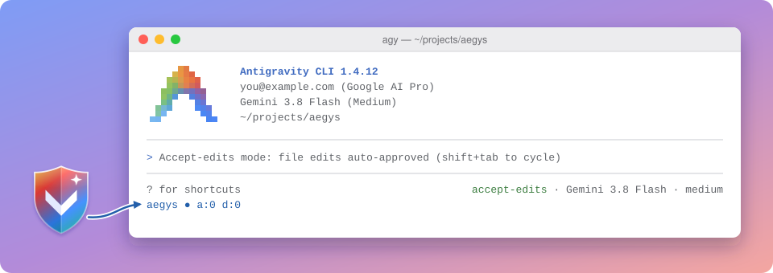

<p align="center">
  
</p>

<h1 align="center">aegys</h1>

<p align="center">
  <strong>
    Tired of <em>agy</em> asking you for permission on every small thing?<br>
    Longing for the smooth ride of Claude Code's auto mode?<br>
    You've come to the right place.
  </strong>
</p>

---

***aegys*** is a hook for the Antigravity CLI (*agy*). It **looks at each shell command, file read or write, and file search before it runs and decides: let it through, block it, or ask you**. Safe, boring commands run at once. Commands on the deny list never run. Everything in between goes to a small language model, which judges whether the action fits what you asked for.

*aegys* replaces *agy*'s own auto mode, which works only with *agy*'s terminal sandbox switched on. Like Claude Code's auto mode, ***aegys* needs no sandbox**, so **run *agy* in default mode with the sandbox off**. If you leave it on, *aegys* runs the commands it allows outside the sandbox anyway.

## Disclaimer

*aegys* is vibe coded. It guards your machine against one AI agent, and a different AI agent wrote it. **Use it at your own risk.**

## What it does

- Runs commands on a shipped allow list (`git status`, `cat`, `ls`, …) without asking.
- Blocks recursive deletes of critical paths, reads of credential files, environment dumps (`env`, `printenv`, `/proc/*/environ`), and writes to *agy*'s and git's control files and to *aegys* itself. A `ps` that may print environments is blocked or goes to the classifier; it never runs at once.
- Blocks a search that walks a folder (`grep -r`, `rg`, `diff -r`) unless it excludes `.env`, `.env.*` and `.git` by name. `git diff --no-index` of two folders cannot exclude them, so it is always blocked.
- Blocks URLs on a deny list and private, loopback or cloud-metadata addresses, except exact `host:port` loopback endpoints listed in `allowedLoopbackEndpoints`.
- Asks you before `sudo`, `doas`, and commands on your own ask list.
- Sends the rest to a classifier model of your choice, which allows or denies. When the agent retries a denied risky operation by another route without your authorization, *aegys* denies again and tells it to change course.
- Allows file reads and writes inside your workspace, except config files such as `.git` or `.bashrc`, and writes into a folder laid out like `.git`; checks the rest the same way as commands.
- Lets `list_directory`, `find`, and `grep_search` of a single file search outside the workspace, and keeps them allowed with `/aegys off`. It denies them only for credential paths, and for `grep_search` and `find` a folder above one. For `grep_search` of a folder the guard cannot tell whether it excludes `.env` and `.git`, so it goes to the classifier, or asks you with `/aegys off`.
- `/aegys off` hands decisions back to you for one conversation: hard blocks stay, and most commands ask first. `/aegys on` switches the guard back.
- Reads your own allow/ask/deny lists and settings from `~/.gemini/aegys/config.json` on top of the shipped defaults.
- Asks you instead of guessing when its config is broken or the classifier is unreachable.

You choose the classifier model with `classifierModel` in `~/.gemini/aegys/config.json`, and give *aegys* its API key. The default model is Claude Haiku 5.5. The classifier always runs at low effort; a configurable effort is tracked in [#13](https://github.com/maxsroda/aegys/issues/13).

> **Note:** for now *aegys* speaks only Anthropic's API, so the model must be a Claude model or sit behind an Anthropic-compatible endpoint set with `anthropicBaseUrl` in the same file, and the key goes in `ANTHROPIC_API_KEY`. Support for other providers is tracked in [#13](https://github.com/maxsroda/aegys/issues/13).

## What the classifier sees

On each call it judges, the classifier gets:

- The action: the full text of a shell command; for a file or search tool, its name and arguments as JSON, cut to 8000 characters.
- Your messages and the agent's tool calls with their arguments, from this conversation. Tool outputs and the agent's own prose are not sent.
- The instruction files: `~/.gemini/config/AGENTS.md`, and `AGENTS.md`, `GEMINI.md` and `CLAUDE.md` from each workspace folder. Each is cut to 4000 characters.
- The recent denials in this conversation, so it can spot a retry by another route.

Your messages and the tool calls each get a budget of about 4000 tokens (four characters per token), and one entry is cut at about 1000 tokens. Only the 40 most recent tool calls are sent.

## Install

```sh
uv tool install git+https://github.com/maxsroda/aegys
aegys install
export ANTHROPIC_API_KEY=...   # in the shell that starts agy
```

[uv](https://docs.astral.sh/uv/) puts *aegys* in `~/.local/bin/aegys`, where the hooks run it. `aegys install` then wires it into *agy* and leaves the rest of your config alone:

- `~/.gemini/config/hooks.json` gets an `aegys` entry that runs the guard before every shell command, file tool and search, and reads `/aegys on` and `/aegys off`.
- `~/.gemini/antigravity-cli/settings.json` gets the grants that let *agy* run what *aegys* allows (`command(regex:(?s).*)`, `read_file($HOME)`, `write_file($HOME)`) and the status line. A status line of your own stays; the install tells you how to switch it.

After this, **_aegys_ is the only check between the agent and your shell and home folder**: the grants switch off *agy*'s own prompts. So `aegys install` stops without changing anything if `~/.local/bin/aegys` is missing or a config file does not parse, writes the hooks before the grants, and copies each file to `*.aegys-backup` first. Running it again changes nothing. The agent itself cannot run it: *aegys* blocks `aegys install` and `aegys uninstall` inside *agy*.

To update, run `uv tool upgrade aegys`.

## The status chip

The status line shows how the guard is doing in this conversation:

```
aegys ● a:12 d:2 ca:5 cd:1
```

- `●` the guard is on; `○` it is off (`/aegys off`).
- `a:` calls allowed so far.
- `d:` calls denied, for any reason: a deny rule, a hard block, or the classifier.
- `ca:` / `cd:` the classifier's own allows and denies. They appear after its first decision. `a:` and `d:` include them.

The chip turns amber with a `⚠` note when *agy*'s own auto mode or its sandbox is on, and red `aegys ✗` with the reason when the hook is missing or your config is broken. The chip and its counters follow [pi-automode](https://github.com/czottmann/pi-automode)'s `AM ● a:… d:… ca:… cd:…`.

No chip means *aegys* isn't running. If its program is gone but its hooks stay, *agy* refuses every shell command with a `hook failed` error instead of running it unchecked. To uninstall, run `aegys uninstall`, then `uv tool uninstall aegys`. `aegys install` records which grants it added in `~/.gemini/aegys/installed.json`, so the uninstall takes back only those, plus the hooks and the aegys status line; grants you had before stay. The exception is `command(regex:(?s).*)`: without the hook it lets *agy* run every command unasked, so the uninstall always removes it.

## Trust, but verify

Don't take this README's word for it. **Read the code**, starting with the docstring of `aegys/guard.py`, to see exactly what gets allowed. Or ask a coding agent you trust to read it for you.

## License

MIT. The classifier's rules and two-stage design come from [pi-automode](https://github.com/czottmann/pi-automode) by Carlo Zottmann, also MIT; see `LICENSE`.
